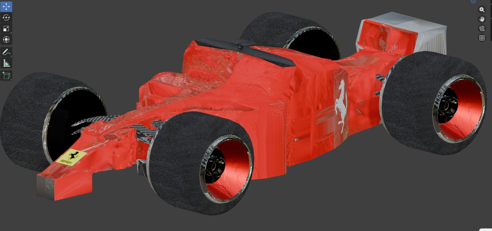
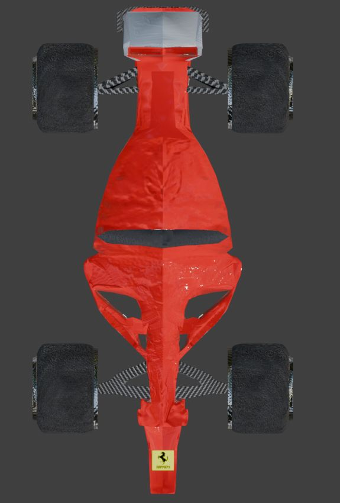
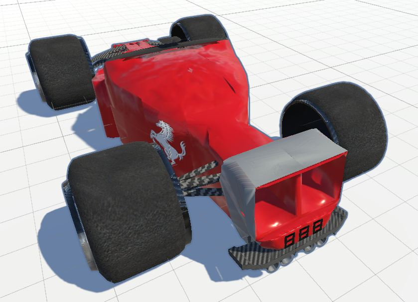

# Ferrari 3D Model

A 3D modeling project featuring a Ferrari sports car, created using Blender and presented in Unity.

## Main Render

## Project Overview

This project showcases a 3D Ferrari model created as a personal 3D modeling project. The repository contains the model's source files, project resources, and screenshots demonstrating the result from different perspectives.

## Gallery

### Top View

### Unity Presentation

## Tools & Technologies

- **Blender** — 3D modeling and rendering.
- **Unity** — real-time 3D presentation.
- **Git & GitHub** — version control and project hosting.

## Project Highlights

- 3D sports car modeling.
- Visual presentation from multiple camera angles.
- Integration of 3D assets into a Unity project.
- Organized project files and visual documentation.

## Repository Contents

- `Screenshots/` — project screenshots and renders.
- Blender source files — 3D model and related assets.
- Unity project files — resources for presenting the model in Unity.

## Project Status

The project is available for review. Further improvements and refinements may be added over time.
